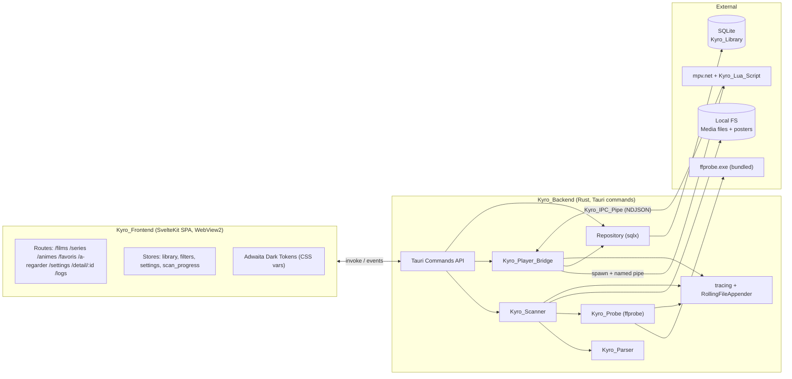
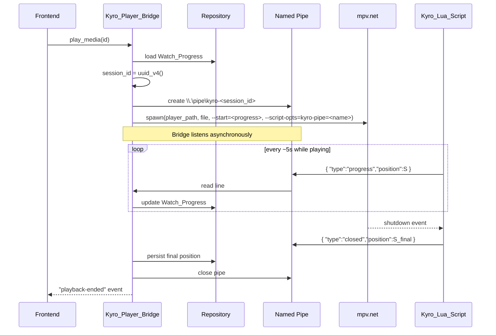

# Design Document — Kyro

## Overview

Kyro est une application desktop Windows construite avec **Tauri 2.x** : un Kyro_Backend en Rust (logique, FS, IPC, persistance) et un Kyro_Frontend Web servi via la WebView native du système (WebView2 sur Windows).

L'objectif est un binaire léger (≤ 50 Mo hors ffprobe), au démarrage rapide (< 3 s), strictement local (aucune requête réseau sortante par défaut), avec une expérience visuelle façon mini Netflix/Plex et une reprise de lecture exacte via un canal IPC dédié vers mpv.net.

### Choix technologiques majeurs

| Domaine | Choix | Justification |
|---|---|---|
| Shell desktop | Tauri 2.x | Binaire compact (< 10 Mo runtime), WebView native (pas de Chromium embarqué), FFI Rust ↔ JS de premier ordre, packaging Windows natif (MSI/NSIS). |
| Backend | Rust (édition 2021) | Performance scan/IO, sécurité mémoire, FFI ffprobe simple via `tokio::process`. |
| Persistance | SQLite via `sqlx` (mode `runtime-tokio-rustls`, pas de `native-tls`) | DB locale, fichier unique, transactions ACID, pas de serveur. `sqlx` permet des migrations versionnées et des requêtes préparées. |
| Logging | `tracing` + `tracing-appender` (RollingFileAppender) | Log rotatif quotidien dans le data dir. |
| Async runtime | `tokio` (multi-thread) | Scan parallèle, IPC asynchrone, processus enfants. |
| IPC mpv | Named pipe Windows (`\\.\pipe\kyro-<session-id>`) + script Lua mpv | Protocole simple ligne-orientée NDJSON, isolation par session. |
| Frontend framework | **SvelteKit en mode SPA (`adapter-static`, `ssr=false`)** | Recommandé. Justification : runtime ~10 KB, compile vers du DOM impératif efficace (gros gains pour les grilles de 5000 items, requirement 13.3), excellente DX, store réactifs natifs simples pour l'état de la library. Alternatives évaluées : React (runtime plus lourd, virtual DOM coûteux pour grilles denses), Solid (excellent mais écosystème UI plus jeune), vanilla JS (productivité moindre). |
| UI tokens | CSS variables natives (pas de framework UI) | Respect strict des tokens Adwaita Dark du requirement 16, zéro dépendance lourde. |
| Build frontend | Vite | Standard SvelteKit, démarrage rapide. |
| Validation | `serde` + types Rust forts | Limites côté backend (notes 0-10, etc.). |

### Périmètre couvert par le design

Toutes les exigences 1 à 18 sont couvertes ci-dessous. Une matrice de traçabilité Requirement ↔ Composant ↔ Propriété figure en fin de document.

## Architecture

### Vue d'ensemble



### Cycle de vie démarrage (requirement 1)

1. `main()` initialise `tracing` (RollingFileAppender quotidien dans `%APPDATA%\Kyro\logs\`).
2. Tauri builder crée la fenêtre principale.
3. Init DB : ouverture `library.db`, exécution des migrations versionnées.
4. Détection ffprobe (sidecar bundled puis fallback `PATH`). Si absent, événement `ffprobe-missing` émis vers le frontend.
5. Si `settings.scan_at_startup = true`, déclenche un scan asynchrone.
6. Si une étape critique échoue (création fenêtre, init DB), l'erreur est loguée et le processus se termine avec un code de sortie ≠ 0 (requirement 1.4).

## Components and Interfaces

### Modules backend Rust

Arborescence cible :

```
src-tauri/src/
├── main.rs                  # init Tauri, logger, DB
├── commands/                # exposées au frontend via #[tauri::command]
│   ├── library.rs           # CRUD Media_Item / Episode_Item / settings
│   ├── scan.rs              # déclenchement scan + progression
│   ├── playback.rs          # play_media, install_lua_script
│   ├── settings.rs          # folders, External_Player, theme
│   └── logs.rs              # lecture du dernier log
├── domain/                  # types métier purs (testable PBT)
│   ├── parser.rs            # Kyro_Parser
│   ├── status.rs            # calcul statut vu/en_cours/non_vu
│   ├── resume.rs            # calcul "prochain épisode à reprendre"
│   ├── filters.rs           # filtrage genre/année/type/statut
│   └── search.rs            # normalisation accents + casse
├── infra/
│   ├── scanner.rs           # Kyro_Scanner (walkdir async)
│   ├── probe.rs             # Kyro_Probe (ffprobe wrapper)
│   ├── player_bridge.rs     # Kyro_Player_Bridge (spawn + pipe)
│   ├── ipc_pipe.rs          # named pipe Windows (tokio::net::windows::named_pipe)
│   ├── repo.rs              # sqlx repository
│   ├── posters.rs           # copie d'affiches dans data dir
│   └── ffprobe_locator.rs   # détection / sidecar
├── error.rs                 # KyroError, conversions
└── migrations/              # SQL versionnées
    ├── 0001_init.sql
    └── ...
```

### Kyro_Scanner (requirement 3)

Responsabilités : parcours récursif, filtrage extensions, détection nouveau / modifié / disparu, émission d'événements de progression.

Pseudocode :

```rust
pub struct ScanReport {
    pub total_files: usize,
    pub processed: usize,
    pub created: usize,
    pub updated: usize,
    pub marked_unavailable: usize,
    pub failures: Vec<ScanFailure>,
}

pub async fn scan_all(
    repo: &Repo,
    parser: &Parser,
    probe: &Probe,
    folders: &[LibraryFolder],
    progress_tx: tauri::Window,
) -> Result<ScanReport, KyroError> {
    // 1. Walk every folder recursively (jwalk / async walkdir)
    // 2. Filter by SUPPORTED_EXTENSIONS
    // 3. For each candidate path:
    //    - Compute (path_abs, size). If repo has matching record => skip (3.3).
    //    - Else parse filename via Kyro_Parser, classify by folder category,
    //      probe via Kyro_Probe, persist via repo.
    //    - On parse/probe error: log with file path, continue (18.1).
    //    - Emit "scan-progress" event { processed, total }.
    // 4. Mark records whose file no longer exists as `available = false` (3.5).
}
```

Constantes :

```rust
const SUPPORTED_EXTENSIONS: &[&str] = &[
    "mkv", "mp4", "avi", "mov", "webm", "m4v", "ts", "wmv",
];
```

### Kyro_Parser (requirement 4)

Module pur (aucune IO), idéal pour PBT. Stratégie : pipeline de regex appliquées sur le nom de fichier sans extension.

```rust
pub struct ParsedFilename {
    pub title: String,
    pub year: Option<u16>,
    pub quality: Option<Quality>,
    pub episode: Option<EpisodeNumbering>,
}

pub struct EpisodeNumbering {
    pub season: u16,
    pub episode: u16,
    pub source: NumberingSource, // SxxExx | NxN | EpOnly
}

pub fn parse(filename: &str) -> ParsedFilename {
    let stem = strip_extension(filename);
    let quality = extract_quality(stem);          // 4.3
    let year = extract_year(stem);                // 4.2
    let episode = extract_sxxexx(stem)            // 4.4 (S01E02, s1e2 ...)
        .or_else(|| extract_n_x_n(stem))          // 4.5 (1x02)
        .or_else(|| extract_loose_episode(stem)); // 4.6 (ép. 12, ep 12, episode 12, - 12)
    let title = clean_title(stem, &quality, &year, &episode); // 4.1
    ParsedFilename { title, year, quality, episode }
}
```

Regex clés (tous flags `i`) :

| Pattern | Regex |
|---|---|
| Année | `\b(19[0-9]{2}|20[0-9]{2})\b` |
| Qualité | `\b(480p|720p|1080p|1440p|2160p|4k)\b` |
| SxxExx | `\bs(?P<s>\d{1,2})[\s._-]?e(?P<e>\d{1,3})\b` |
| NxN | `\b(?P<s>\d{1,2})x(?P<e>\d{1,3})\b` |
| Épisode souple | `(?:ép\.?|ep\.?|episode|\-)\s*(?P<e>\d{1,3})\b` |

Si aucun pattern d'épisode n'est détecté pour un fichier rangé en catégorie `Séries`/`Animes`, l'item est marqué `numbering_unknown = true` et associé au pseudo-dossier `À classer` (requirement 4.7).

### Kyro_Probe (requirement 5)

Wrapper `tokio::process::Command` autour de ffprobe. Sortie JSON (`-print_format json -show_format -show_streams`).

```rust
pub struct TechnicalMetadata {
    pub duration_seconds: Option<u32>,
    pub video_codec: Option<String>,
    pub width: Option<u32>,
    pub height: Option<u32>,
    pub audio_tracks: Vec<AudioTrack>,
    pub subtitle_tracks: Vec<SubtitleTrack>,
    pub size_bytes: u64,
}

pub async fn probe(path: &Path, ffprobe_bin: &Path) -> Result<TechnicalMetadata, ProbeError> {
    // 1. Run ffprobe -v error -print_format json -show_format -show_streams <path>
    // 2. Parse JSON via serde_json into typed structs.
    // 3. Map to TechnicalMetadata.
    // 4. On non-zero exit or parse failure => Err(ProbeError) (5.5).
}
```

#### Stratégie de packaging ffprobe (requirement 5.3, 5.4)

- **Bundling sidecar** : `tauri.conf.json` déclare `bundle.externalBin = ["ffprobe"]`. Le binaire `ffprobe.exe` (build LGPL minimal) est placé dans `src-tauri/binaries/ffprobe-x86_64-pc-windows-msvc.exe` lors du build CI. Tauri le copie à côté de l'exécutable installé.
- Le `Kyro_Probe` localise ffprobe via cet ordre :
  1. Chemin sidecar résolu par `tauri::api::process::Command::new_sidecar("ffprobe")`.
  2. Chemin défini par l'utilisateur dans les paramètres (`settings.ffprobe_path`).
  3. `which::which("ffprobe")` (PATH système).
- Si aucun n'est trouvable : événement `ffprobe-missing` émis, le frontend affiche un avertissement persistant avec un lien vers la page de paramètres (requirement 5.4). Les scans continuent mais persistent les items avec métadonnées techniques `null` (requirement 5.5).
- La taille de ffprobe (~25 Mo) est exclue du calcul du seuil 50 Mo défini en requirement 1.3 (qui dit explicitement « hors dépendance ffprobe »).

### Kyro_Player_Bridge et Kyro_IPC_Pipe (requirement 9, 10, 12)

Responsabilités : lancer External_Player, créer le named pipe par session, recevoir les positions de lecture, mettre à jour Watch_Progress.

#### Flux de lecture



#### Protocole IPC

Format ligne-orientée NDJSON (UTF-8, 1 message par ligne, `\n` séparateur). Sens unique : Lua → Kyro.

```json
{ "type": "progress", "position": 1234.56, "duration": 5432.10, "session": "9c8b...e1" }
{ "type": "paused",   "position": 1240.00, "session": "9c8b...e1" }
{ "type": "resumed",  "position": 1240.00, "session": "9c8b...e1" }
{ "type": "closed",   "position": 1255.30, "session": "9c8b...e1" }
```

Schéma JSON minimal côté Rust :

```rust
#[derive(serde::Deserialize)]
#[serde(tag = "type", rename_all = "lowercase")]
enum PipeMessage {
    Progress { position: f64, duration: f64, session: String },
    Paused   { position: f64, session: String },
    Resumed  { position: f64, session: String },
    Closed   { position: f64, session: String },
}
```

Côté Rust, le named pipe utilise `tokio::net::windows::named_pipe::NamedPipeServer`. Le nom est `\\.\pipe\kyro-<session_id>` où `session_id` est un UUID v4 généré pour chaque lancement (requirement 9.6).

#### Kyro_Lua_Script (script mpv côté client)

Installé via la commande Tauri `install_lua_script` qui copie le fichier dans `%APPDATA%\mpv.net\scripts\kyro.lua` (requirement 9.7). Pseudocode Lua :

```lua
-- kyro.lua : push position to a named pipe given by --script-opts=kyro-pipe=<name>
local mp = require 'mp'
local opts = mp.get_property_native("options/script-opts") or {}
local pipe_name = opts["kyro-pipe"]
if not pipe_name then return end

local session = pipe_name:match("kyro%-(.+)$") or ""
local f = io.open("\\\\.\\pipe\\" .. pipe_name, "wb")
if not f then return end

local function send(t)
  local pos = mp.get_property_number("time-pos") or 0
  local dur = mp.get_property_number("duration") or 0
  local line = string.format(
    '{"type":"%s","position":%.3f,"duration":%.3f,"session":"%s"}\n',
    t, pos, dur, session)
  f:write(line); f:flush()
end

mp.add_periodic_timer(5, function() send("progress") end)  -- 9.2
mp.register_event("pause",    function() send("paused")  end)
mp.register_event("unpause",  function() send("resumed") end)
mp.register_event("shutdown", function()                  -- 9.3
  send("closed")
  if f then f:close() end
end)
```

#### Lecteur autre que mpv.net (requirement 10.5)

Si `settings.external_player_path` ne se résout pas comme `mpv.net.exe` (détection par nom de fichier insensible à la casse), le bridge ne crée pas de pipe, lance simplement le lecteur avec le chemin du fichier, et la fiche du Media_Item affiche un badge « reprise exacte non garantie ».

#### Validation existence External_Player (requirement 10.3, 10.4)

Au moment de l'enregistrement du chemin et au moment du lancement : `std::fs::metadata(path)?.is_file()` + `std::fs::metadata(path)?.permissions()` (sous Windows : extension `.exe`). En cas d'absence au lancement : événement frontend `external-player-missing`.

### Repository (sqlx)

Couche d'accès DB avec requêtes préparées. Toutes les mutations passent par une transaction et signalent succès uniquement après `COMMIT` (requirement 17.2).

```rust
pub trait Repository {
    async fn upsert_media_item(&self, item: &MediaItem) -> Result<MediaItemId, KyroError>;
    async fn upsert_episode_item(&self, ep: &EpisodeItem) -> Result<EpisodeItemId, KyroError>;
    async fn set_watch_progress(&self, target: ProgressTarget, position: u32) -> Result<Status, KyroError>;
    async fn list_by_category(&self, c: Category) -> Result<Vec<MediaItem>, KyroError>;
    async fn search(&self, q: &str) -> Result<Vec<MediaItem>, KyroError>;
    async fn list_favorites(&self) -> Result<Vec<MediaItem>, KyroError>;
    async fn list_to_watch(&self) -> Result<Vec<MediaItem>, KyroError>;
    async fn next_resume_episode(&self, series_id: MediaItemId) -> Result<Option<EpisodeItem>, KyroError>;
    async fn add_library_folder(&self, path: &Path, category: Category) -> Result<FolderId, KyroError>;
    async fn remove_library_folder(&self, id: FolderId) -> Result<(), KyroError>;
    async fn list_library_folders(&self) -> Result<Vec<LibraryFolder>, KyroError>;
    async fn upsert_setting(&self, key: &str, value: &str) -> Result<(), KyroError>;
}
```

### Frontend (SvelteKit SPA)

#### Routes / Pages

| Route | Rôle | Couvre |
|---|---|---|
| `/` | Redirige vers la dernière catégorie consultée (par défaut `/films`). | 7.1 |
| `/films` | Grille des Films. | 7.1, 7.2, 15 |
| `/series` | Grille des Séries. | 7.1, 7.2 |
| `/animes` | Grille des Animes. | 7.1, 7.2 |
| `/favoris` | Liste filtrée `favori = true`. | 11.4 |
| `/a-regarder` | Liste filtrée `à_regarder = true`. | 11.5 |
| `/detail/:id` | Fiche d'un Media_Item, saisons/épisodes si série/anime, bouton Reprendre / Revoir. | 6, 7.3, 7.4, 8.5, 11, 12, 15.4 |
| `/edit/:id` | Formulaire d'édition (titre, année, synopsis, genres, note, studio, statut, affiche). | 6 |
| `/edit-episode/:id` | Édition d'un Episode_Item. | 6.5 |
| `/settings` | Dossiers, catégorie, External_Player, ffprobe path, scan_au_démarrage, thème, install Lua script. | 2, 5.4, 9.7, 10, 16.14 |
| `/logs` | Vue du fichier journal le plus récent. | 18.3 |

#### State management

Stores Svelte minimalistes :

```ts
// stores/library.ts
export const items = writable<MediaItem[]>([]);
export const episodes = writable<Map<MediaItemId, EpisodeItem[]>>(new Map());
export const filters = writable<Filters>({ genres: [], years: [], types: [], statuses: [] });
export const search = writable<string>("");
export const settings = writable<Settings>(defaultSettings);
export const scanProgress = writable<ScanProgress | null>(null);
export const flags = writable<{ ffprobeMissing: boolean; backendDegraded: boolean }>(...);

// derived
export const filteredItems = derived([items, filters, search],
  ([$items, $f, $q]) => applyFilters($items, $f, $q));
```

Communication avec le backend :

```ts
import { invoke } from "@tauri-apps/api/core";
import { listen } from "@tauri-apps/api/event";

await invoke("list_by_category", { category: "Films" });
listen("scan-progress", e => scanProgress.set(e.payload));
listen("ffprobe-missing", () => flags.update(f => ({ ...f, ffprobeMissing: true })));
listen("backend-degraded", () => flags.update(f => ({ ...f, backendDegraded: true })));
```

#### Recherche et filtres (requirements 13, 14)

- Recherche : normalisation Unicode NFD + `replace(/\p{M}/gu, "")` + `toLocaleLowerCase()` (insensible casse + accents — requirement 13.2).
- Filtrage côté client (les 5000 items tiennent en mémoire ; benchmark cible < 50 ms par re-filtre — requirement 13.3).
- Filtres genre = union ; combinaison avec autres dimensions = intersection (requirement 14.2, 14.3).

#### Composants UI (CSS variables Adwaita Dark)

Pas de framework UI : composants Svelte custom (`<MediaCard>`, `<Sidebar>`, `<TopBar>`, `<FilterChip>`, `<HoverOverlay>`, `<RatingInput>`, `<PosterPicker>`).

## Data Models

### Schéma de base de données

```mermaid
erDiagram
    LIBRARY_FOLDER ||--o{ MEDIA_ITEM : contains
    MEDIA_ITEM ||--o{ EPISODE_ITEM : has
    MEDIA_ITEM ||--o{ MEDIA_GENRE : has
    GENRE ||--o{ MEDIA_GENRE : tagged_in
    MEDIA_ITEM ||--o{ AUDIO_TRACK : has
    MEDIA_ITEM ||--o{ SUBTITLE_TRACK : has
    EPISODE_ITEM ||--o{ AUDIO_TRACK : has
    EPISODE_ITEM ||--o{ SUBTITLE_TRACK : has
    SETTINGS ||--o{ SETTING_VALUE : holds

    LIBRARY_FOLDER {
        INTEGER id PK
        TEXT path UNIQUE
        TEXT category
        DATETIME created_at
    }
    MEDIA_ITEM {
        INTEGER id PK
        INTEGER folder_id FK
        TEXT type
        TEXT file_path
        INTEGER size_bytes
        TEXT title
        TEXT original_title
        INTEGER year
        TEXT quality
        TEXT synopsis
        TEXT studio
        INTEGER user_rating
        TEXT poster_path
        INTEGER duration_seconds
        TEXT video_codec
        INTEGER width
        INTEGER height
        INTEGER watch_progress_seconds
        TEXT status
        INTEGER favorite
        INTEGER to_watch
        INTEGER available
        INTEGER numbering_unknown
        DATETIME last_scanned_at
    }
    EPISODE_ITEM {
        INTEGER id PK
        INTEGER series_id FK
        INTEGER season_number
        INTEGER episode_number
        TEXT file_path
        INTEGER size_bytes
        TEXT title
        TEXT synopsis
        INTEGER duration_seconds
        TEXT video_codec
        INTEGER width
        INTEGER height
        INTEGER watch_progress_seconds
        TEXT status
        INTEGER available
        INTEGER numbering_unknown
        TEXT poster_path
        DATETIME last_scanned_at
    }
    GENRE {
        INTEGER id PK
        TEXT name UNIQUE
    }
    MEDIA_GENRE {
        INTEGER media_item_id FK
        INTEGER genre_id FK
    }
    AUDIO_TRACK {
        INTEGER id PK
        INTEGER media_item_id FK
        INTEGER episode_item_id FK
        TEXT codec
        TEXT language
    }
    SUBTITLE_TRACK {
        INTEGER id PK
        INTEGER media_item_id FK
        INTEGER episode_item_id FK
        TEXT codec
        TEXT language
    }
    SETTINGS {
        INTEGER id PK
    }
    SETTING_VALUE {
        TEXT key PK
        TEXT value
    }
```

### DDL SQLite (migration 0001_init.sql, extrait)

```sql
PRAGMA foreign_keys = ON;

CREATE TABLE library_folder (
  id          INTEGER PRIMARY KEY AUTOINCREMENT,
  path        TEXT NOT NULL UNIQUE,
  category    TEXT NOT NULL CHECK (category IN ('Films','Series','Animes')),
  created_at  DATETIME NOT NULL DEFAULT CURRENT_TIMESTAMP
);

CREATE TABLE media_item (
  id                       INTEGER PRIMARY KEY AUTOINCREMENT,
  folder_id                INTEGER REFERENCES library_folder(id) ON DELETE SET NULL,
  type                     TEXT NOT NULL CHECK (type IN ('Film','Series','Anime')),
  file_path                TEXT,                              -- NULL si Series/Anime racine
  size_bytes               INTEGER,
  title                    TEXT NOT NULL,
  original_title           TEXT,
  year                     INTEGER,
  quality                  TEXT,
  synopsis                 TEXT,
  studio                   TEXT,
  user_rating              INTEGER CHECK (user_rating BETWEEN 0 AND 10),
  poster_path              TEXT,
  duration_seconds         INTEGER,
  video_codec              TEXT,
  width                    INTEGER,
  height                   INTEGER,
  watch_progress_seconds   INTEGER NOT NULL DEFAULT 0 CHECK (watch_progress_seconds >= 0),
  status                   TEXT NOT NULL DEFAULT 'non_vu'
                           CHECK (status IN ('non_vu','en_cours','vu')),
  favorite                 INTEGER NOT NULL DEFAULT 0 CHECK (favorite IN (0,1)),
  to_watch                 INTEGER NOT NULL DEFAULT 0 CHECK (to_watch IN (0,1)),
  available                INTEGER NOT NULL DEFAULT 1 CHECK (available IN (0,1)),
  numbering_unknown        INTEGER NOT NULL DEFAULT 0 CHECK (numbering_unknown IN (0,1)),
  last_scanned_at          DATETIME
);
CREATE INDEX idx_media_item_type    ON media_item(type);
CREATE INDEX idx_media_item_status  ON media_item(status);
CREATE INDEX idx_media_item_year    ON media_item(year);
CREATE INDEX idx_media_item_title   ON media_item(title COLLATE NOCASE);

CREATE TABLE episode_item (
  id                       INTEGER PRIMARY KEY AUTOINCREMENT,
  series_id                INTEGER NOT NULL REFERENCES media_item(id) ON DELETE CASCADE,
  season_number            INTEGER NOT NULL,
  episode_number           INTEGER NOT NULL,
  file_path                TEXT NOT NULL UNIQUE,
  size_bytes               INTEGER,
  title                    TEXT,
  synopsis                 TEXT,
  duration_seconds         INTEGER,
  video_codec              TEXT,
  width                    INTEGER,
  height                   INTEGER,
  watch_progress_seconds   INTEGER NOT NULL DEFAULT 0 CHECK (watch_progress_seconds >= 0),
  status                   TEXT NOT NULL DEFAULT 'non_vu'
                           CHECK (status IN ('non_vu','en_cours','vu')),
  available                INTEGER NOT NULL DEFAULT 1 CHECK (available IN (0,1)),
  numbering_unknown        INTEGER NOT NULL DEFAULT 0 CHECK (numbering_unknown IN (0,1)),
  poster_path              TEXT,
  last_scanned_at          DATETIME
);
CREATE INDEX idx_episode_series ON episode_item(series_id, season_number, episode_number);

CREATE TABLE genre (
  id   INTEGER PRIMARY KEY AUTOINCREMENT,
  name TEXT NOT NULL UNIQUE
);

CREATE TABLE media_genre (
  media_item_id INTEGER NOT NULL REFERENCES media_item(id) ON DELETE CASCADE,
  genre_id      INTEGER NOT NULL REFERENCES genre(id) ON DELETE CASCADE,
  PRIMARY KEY (media_item_id, genre_id)
);

CREATE TABLE audio_track (
  id              INTEGER PRIMARY KEY AUTOINCREMENT,
  media_item_id   INTEGER REFERENCES media_item(id) ON DELETE CASCADE,
  episode_item_id INTEGER REFERENCES episode_item(id) ON DELETE CASCADE,
  codec           TEXT,
  language        TEXT,
  CHECK ((media_item_id IS NULL) <> (episode_item_id IS NULL))
);
CREATE TABLE subtitle_track (
  id              INTEGER PRIMARY KEY AUTOINCREMENT,
  media_item_id   INTEGER REFERENCES media_item(id) ON DELETE CASCADE,
  episode_item_id INTEGER REFERENCES episode_item(id) ON DELETE CASCADE,
  codec           TEXT,
  language        TEXT,
  CHECK ((media_item_id IS NULL) <> (episode_item_id IS NULL))
);

CREATE TABLE setting_value (
  key   TEXT PRIMARY KEY,
  value TEXT NOT NULL
);
-- Clés attendues : external_player_path, ffprobe_path, theme,
--                  scan_at_startup, last_category.
```

### Emplacement des données (requirement 17)

- DB : `%APPDATA%\Kyro\library.db` (résolu via `tauri::api::path::app_data_dir`).
- Affiches copiées : `%APPDATA%\Kyro\posters\<media_id>.<ext>` (requirement 6.3).
- Logs : `%APPDATA%\Kyro\logs\kyro.log.YYYY-MM-DD` (rotatif quotidien — requirement 18.2).
- À la désinstallation, l'installeur (NSIS / WiX) ne supprime PAS `%APPDATA%\Kyro\` par défaut (requirement 17.4) ; une option « Supprimer aussi mes données » est exposée dans l'installeur.

### Tokens du thème Adwaita Dark (requirement 16)

CSS injecté à la racine de l'application. Tokens exhaustifs dérivés strictement du requirement 16.

```css
:root[data-theme="adwaita-dark"] {
  /* Backgrounds */
  --bg-primary:    #1e1e2e;   /* 16.2 */
  --bg-secondary:  #242535;   /* 16.3 */
  --surface:       #2a2b3d;   /* 16.4 */

  /* Borders */
  --border:        #383a4f;   /* 16.5 */

  /* Text */
  --text-primary:   #e6e6ec;  /* 16.6 */
  --text-secondary: #a8a8b5;  /* 16.7 */

  /* Accent (bleu, jamais violet/néon — 16.13) */
  --accent:        #3584e4;   /* 16.8 */
  --accent-hover:  #1c71d8;   /* 16.9 */

  /* Radii */
  --radius-card:    12px;     /* 16.10 */
  --radius-control: 8px;      /* 16.11 */

  /* Typography (16.12) */
  --font-family: "Inter", -apple-system, "Segoe UI", system-ui, sans-serif;

  /* Spacing scale (cohérence visuelle desktop premium) */
  --space-1: 4px;
  --space-2: 8px;
  --space-3: 12px;
  --space-4: 16px;
  --space-5: 24px;
  --space-6: 32px;

  /* Elevation */
  --shadow-card: 0 1px 2px rgba(0,0,0,.4), 0 4px 12px rgba(0,0,0,.25);
}

/* Thème clair équivalent (16.14) — palette Adwaita light cohérente */
:root[data-theme="adwaita-light"] {
  --bg-primary:    #fafafb;
  --bg-secondary:  #f0f0f3;
  --surface:       #ffffff;
  --border:        #d3d4dc;
  --text-primary:  #1d1d22;
  --text-secondary:#5c5d6b;
  --accent:        #3584e4;
  --accent-hover:  #1c71d8;
  --radius-card:    12px;
  --radius-control: 8px;
  --font-family: "Inter", -apple-system, "Segoe UI", system-ui, sans-serif;
  --shadow-card: 0 1px 2px rgba(0,0,0,.06), 0 4px 12px rgba(0,0,0,.08);
}

html, body { background: var(--bg-primary); color: var(--text-primary); font-family: var(--font-family); }
.card     { background: var(--surface); border: 1px solid var(--border); border-radius: var(--radius-card); box-shadow: var(--shadow-card); }
button, input, select { border-radius: var(--radius-control); }
button.primary       { background: var(--accent); color: var(--text-primary); }
button.primary:hover { background: var(--accent-hover); }
```

Le bascule clair/sombre (requirement 16.14) modifie l'attribut `data-theme` sur `<html>` et persiste dans `setting_value(key='theme')`. Au premier démarrage, valeur initiale `adwaita-dark` (requirement 16.1).

### Fonctions de domaine clés

#### Calcul du statut (requirement 8.2, 8.3)

```rust
pub fn compute_status(progress: u32, duration_seconds: u32, manual_override: Option<Status>) -> Status {
    if let Some(s) = manual_override {           // 8.4
        return s;
    }
    if duration_seconds == 0 { return Status::NonVu; }
    let ratio = progress as f64 / duration_seconds as f64;
    match ratio {
        r if r > 0.9 => Status::Vu,               // 8.2
        r if r > 0.0 => Status::EnCours,          // 8.3
        _            => Status::NonVu,
    }
}
```

#### Calcul "prochain épisode à reprendre" (requirement 12.1)

```rust
pub fn next_resume(episodes: &[EpisodeItem]) -> ResumeAction {
    let mut sorted: Vec<&EpisodeItem> = episodes.iter()
        .filter(|e| e.available)
        .collect();
    sorted.sort_by_key(|e| (e.season_number, e.episode_number));

    if sorted.iter().all(|e| e.status == Status::Vu) {
        return ResumeAction::RewatchFromStart(sorted.first().copied()); // 12.3
    }
    if let Some(in_progress) = sorted.iter().find(|e| e.status == Status::EnCours) {
        return ResumeAction::Resume(*in_progress);                       // 12.1 priorité 1
    }
    if let Some(first_unseen) = sorted.iter().find(|e| e.status == Status::NonVu) {
        return ResumeAction::Resume(*first_unseen);                      // 12.1 priorité 2
    }
    ResumeAction::None
}
```

## Error Handling

### Politique générale

- Toute erreur dans Kyro_Scanner / Kyro_Parser / Kyro_Probe / Kyro_Player_Bridge est journalisée avec le chemin du fichier concerné et n'interrompt pas le traitement des autres fichiers (requirement 18.1).
- `KyroError` est un enum thiserror unifiant : `Io`, `Db`, `Probe`, `Parse`, `Ipc`, `Config`, `Validation`. Conversion vers `tauri::InvokeError` pour remontée frontend.
- Les commands renvoient `Result<T, String>` au frontend (avec un message FR localisé) ; le détail technique reste dans les logs.

### Logging

```rust
use tracing_subscriber::{fmt, EnvFilter};
use tracing_appender::rolling::{RollingFileAppender, Rotation};

let appender = RollingFileAppender::new(
    Rotation::DAILY,
    app_data_dir.join("logs"),
    "kyro.log",
);
let (nb, _guard) = tracing_appender::non_blocking(appender);
tracing_subscriber::fmt()
    .with_env_filter(EnvFilter::try_from_default_env().unwrap_or_else(|_| EnvFilter::new("info,sqlx=warn")))
    .with_writer(nb)
    .with_ansi(false)
    .json()
    .init();
```

- Niveau par défaut : `info`. `debug` activable via variable `KYRO_LOG`.
- Format JSON ligne pour parsing futur. Champs : `timestamp`, `level`, `target`, `message`, `file_path` (quand pertinent).
- Page `/logs` côté frontend lit le dernier fichier via la commande `read_latest_log` (lecture seule, max 5 MB).

### Mode dégradé (requirement 18.4)

Si une commande échoue de manière irrécupérable (ex. DB verrouillée), le backend émet l'événement `backend-degraded`. Le store `flags.backendDegraded` est observé dans `+layout.svelte` ; un bandeau rouge s'affiche en haut de l'application avec un bouton « Relancer ».

### Garantie zéro réseau (requirements 6.4, 17.3)

- Aucune dépendance HTTP n'est ajoutée au `Cargo.toml` (pas de `reqwest`, `ureq`, etc.).
- Une feature flag `network` (désactivée par défaut) est prévue pour de futurs usages opt-in explicites de l'utilisateur.
- Test d'intégration : un test Rust monte un proxy TCP local et vérifie qu'aucune connexion sortante n'est établie pendant un scan + un cycle d'édition + un cycle de lecture mockée.

## Correctness Properties

*Une propriété est une caractéristique ou un comportement qui doit rester vrai pour toute exécution valide du système. Les propriétés font le pont entre la spécification humaine et les garanties vérifiables par machine.*

### Property 1: Round-trip d'ajout / lecture d'un dossier de bibliothèque

*For any* chemin de dossier valide `p` et catégorie `c ∈ {Films, Séries, Animes}`, après `add_library_folder(p, c)` puis `list_library_folders()`, le résultat contient exactement une entrée dont `path = p` et `category = c`.

**Validates: Requirements 2.2, 2.5**

### Property 2: Retrait d'un dossier marque tous ses items indisponibles

*For any* bibliothèque contenant un dossier `f` avec `n ≥ 0` Media_Item / Episode_Item rattachés, après `remove_library_folder(f)`, tous les items précédemment rattachés ont `available = false` et aucun n'a été supprimé.

**Validates: Requirements 2.3**

### Property 3: Idempotence du scan

*For any* arborescence de fichiers `T`, exécuter `scan_all` deux fois successivement produit la même Kyro_Library : le second scan ne crée aucune nouvelle entrée et ne modifie pas les entrées existantes pour les fichiers dont le chemin et la taille sont inchangés.

**Validates: Requirements 3.3, 3.4**

### Property 4: Filtrage par extensions supportées

*For any* ensemble de fichiers présentés au Kyro_Scanner, l'ensemble des fichiers retenus est exactement le sous-ensemble dont l'extension (insensible à la casse) appartient à `SUPPORTED_EXTENSIONS`.

**Validates: Requirements 3.2**

### Property 5: Détection de fichiers disparus

*For any* entrée existante dans Kyro_Library dont le fichier n'est plus présent sur le système de fichiers au moment d'un scan, après le scan l'entrée existe encore et a `available = false`.

**Validates: Requirements 3.5**

### Property 6: Round-trip parse / format des noms de fichier

*For any* triplet (titre, année optionnelle, qualité optionnelle) et toute numérotation d'épisode (`SxxExx`, `NxN`, ou patterns souples), si on construit un nom de fichier canonique à partir de ces composants, alors `Kyro_Parser.parse(filename)` extrait exactement le même titre (à normalisation près des délimiteurs), la même année, la même qualité et la même numérotation. La saison vaut `1` par défaut pour les patterns souples.

**Validates: Requirements 4.1, 4.2, 4.3, 4.4, 4.5, 4.6**

### Property 7: Marquage numérotation inconnue

*For any* nom de fichier sans aucun motif de numérotation reconnu, lorsqu'il est rangé sous une catégorie `Séries` ou `Animes`, l'Episode_Item résultant a `numbering_unknown = true` et est associé au pseudo-dossier `À classer`.

**Validates: Requirements 4.7**

### Property 8: Persistance fidèle de la taille de fichier

*For any* fichier `f` indexé par Kyro, le champ `size_bytes` persisté est égal à la taille rapportée par le système de fichiers pour `f` au moment du scan.

**Validates: Requirements 5.2**

### Property 9: Mapping ffprobe → métadonnées techniques

*For any* sortie JSON valide de ffprobe, les champs `duration_seconds`, `video_codec`, `width`, `height`, et les listes `audio_tracks` et `subtitle_tracks` du Media_Item / Episode_Item résultant reflètent exactement les valeurs présentes dans la sortie ffprobe.

**Validates: Requirements 5.1, 5.6**

### Property 10: Robustesse du probe en cas d'échec

*For any* fichier pour lequel l'invocation ffprobe échoue (non-zero exit, JSON invalide, ou binaire absent), l'entrée dans Kyro_Library existe avec ses métadonnées techniques marquées `null`, une entrée de log contient le chemin du fichier, et le scan continue avec les autres fichiers.

**Validates: Requirements 5.5, 18.1**

### Property 11: Round-trip d'édition d'une fiche

*For any* fiche valide (titre non vide, année dans `[1900, 2099]` ou nulle, note dans `[0, 10]` ou nulle, etc.), `update(fiche)` puis `read(id)` renvoie une fiche égale à la fiche soumise.

**Validates: Requirements 6.1, 6.3, 17.2**

### Property 12: Validation de la note utilisateur

*For any* valeur de note hors de l'intervalle `[0, 10]`, `update(fiche_avec_note_invalide)` est rejeté, la fiche persistée n'est pas modifiée, et un message d'erreur indiquant la plage autorisée est retourné.

**Validates: Requirements 6.6**

### Property 13: Aucune requête réseau sortante

*For any* séquence d'opérations utilisateur (ajout dossier, scan, édition, lecture, recherche, filtres), aucune connexion réseau sortante n'est tentée par Kyro_Backend.

**Validates: Requirements 6.4, 17.3**

### Property 14: Filtrage par catégorie

*For any* bibliothèque mixte et toute catégorie `c ∈ {Films, Séries, Animes}`, la liste retournée par `list_by_category(c)` contient exactement les Media_Item dont `type` correspond à `c`.

**Validates: Requirements 7.2**

### Property 15: Tri saisons puis épisodes

*For any* Media_Item de type `Série` ou `Anime`, la liste de ses Episode_Item retournée pour l'affichage est triée par `(season_number ASC, episode_number ASC)`.

**Validates: Requirements 7.3, 7.4**

### Property 16: Calcul déterministe du statut

*For any* couple `(progress, duration)` avec `duration > 0` et `0 ≤ progress ≤ duration`, le statut calculé satisfait :
- `progress / duration > 0.9 ⟹ statut = vu`
- `0 < progress / duration ≤ 0.9 ⟹ statut = en_cours`
- `progress = 0 ⟹ statut = non_vu`

**Validates: Requirements 8.2, 8.3**

### Property 17: Prévalence du statut manuel

*For any* Media_Item / Episode_Item, si l'utilisateur force manuellement `statut = vu` ou `statut = non_vu`, la valeur reste celle forcée jusqu'à ce qu'une nouvelle Watch_Progress soit reçue.

**Validates: Requirements 8.4**

### Property 18: Compteur épisodes vus

*For any* série, le compteur affiché « X / N épisodes vus » satisfait `X = card({e ∈ episodes | e.status = vu})` et `N = card(episodes)`.

**Validates: Requirements 8.5**

### Property 19: Lancement avec position de reprise

*For any* Media_Item / Episode_Item avec `watch_progress_seconds = p`, lorsque la lecture est lancée via mpv.net, la commande lancée inclut un argument `--start=p`.

**Validates: Requirements 9.1, 12.4**

### Property 20: Mise à jour de Watch_Progress sur message IPC

*For any* séquence de messages NDJSON `{type, position}` reçus sur Kyro_IPC_Pipe pour une session associée à un item `i`, après la fermeture de la session, `i.watch_progress_seconds` est égal à la dernière `position` valide reçue.

**Validates: Requirements 9.3, 9.4**

### Property 21: Préservation en l'absence de message IPC

*For any* session de lecture lancée mais ne recevant aucun message via Kyro_IPC_Pipe, `watch_progress_seconds` de l'item ciblé est inchangé après la fin de la session.

**Validates: Requirements 9.5**

### Property 22: Unicité du nom de pipe par session

*For any* deux lancements distincts de Kyro_Player_Bridge dans une même exécution de Kyro, les noms de pipe générés diffèrent.

**Validates: Requirements 9.6**

### Property 23: Pas d'IPC pour lecteur autre que mpv.net

*For any* configuration où `External_Player ≠ mpv.net`, lors d'un lancement de lecture aucun named pipe n'est créé, aucun message n'est attendu, et l'item est annoté « reprise exacte non garantie ».

**Validates: Requirements 10.5**

### Property 24: Validation du chemin External_Player

*For any* chemin sélectionné comme External_Player, le chemin est persisté si et seulement si le fichier existe et est exécutable au moment de l'enregistrement.

**Validates: Requirements 10.3**

### Property 25: Toggle favori et toggle à_regarder sont des involutions

*For any* Media_Item, appliquer `toggle_favorite` deux fois successivement laisse l'indicateur `favori` inchangé. La même propriété tient pour `toggle_to_watch` sur l'indicateur `à_regarder`.

**Validates: Requirements 11.2, 11.3**

### Property 26: Vue favoris et vue à_regarder

*For any* bibliothèque, `list_favorites()` retourne exactement les Media_Item dont `favori = true`, et `list_to_watch()` retourne exactement ceux dont `à_regarder = true`.

**Validates: Requirements 11.4, 11.5**

### Property 27: Calcul du prochain épisode à reprendre

*For any* série avec liste d'épisodes `E` non vide :
- Si tous les épisodes de `E` ont `statut = vu`, alors `next_resume(E)` retourne l'action `RewatchFromStart` ciblant le premier épisode (ordre saison/épisode).
- Sinon, si au moins un épisode a `statut = en_cours`, `next_resume(E)` retourne le premier de ces épisodes en ordre saison/épisode.
- Sinon, `next_resume(E)` retourne le premier épisode `non_vu` en ordre saison/épisode.

**Validates: Requirements 12.1, 12.2, 12.3**

### Property 28: Recherche insensible à la casse et aux accents

*For any* titre `t` et toute chaîne `q`, l'item `t` apparaît dans le résultat de `search(q)` si et seulement si `normalize(t)` contient `normalize(q)`, où `normalize` retire les diacritiques (NFD + suppression des marques combinantes) et passe en minuscules.

**Validates: Requirements 13.2**

### Property 29: Recherche vide retourne tout

*For any* bibliothèque `L`, `search("")` (chaîne vide) retourne la liste complète `L` de la vue courante, sans filtrage.

**Validates: Requirements 13.4**

### Property 30: Conjonction et union des filtres

*For any* bibliothèque `L` et tout ensemble de filtres `F = (genres, years, types, statuses)`, la liste filtrée contient exactement les items satisfaisant simultanément :
- `(genres = ∅) ∨ (item.genres ∩ genres ≠ ∅)`  *(union sur genres — 14.3)*
- `(years   = ∅) ∨ (item.year ∈ years)`
- `(types   = ∅) ∨ (item.type ∈ types)`
- `(statuses = ∅) ∨ (item.status ∈ statuses)`

(intersection sur les dimensions — 14.2)

**Validates: Requirements 14.2, 14.3**

### Property 31: Filtres vides = identité

*For any* bibliothèque `L`, lorsque tous les filtres sont vides, le résultat affiché est `L` complet et le compteur d'items visibles est égal à `card(L)`.

**Validates: Requirements 14.4, 14.5**

### Property 32: Carte d'item contient affiche / titre / année

*For any* Media_Item, le rendu d'une `MediaCard` contient (a) une affiche — celle du Media_Item si `poster_path` est défini, sinon le visuel par défaut intégré ; (b) le titre ; (c) l'année si elle est définie.

**Validates: Requirements 15.1, 15.2**

### Property 33: Overlay au survol

*For any* Media_Item rendu en `MediaCard`, le rendu de l'overlay de survol contient la note utilisateur, la durée totale (Films) ou le nombre d'épisodes (Séries / Animes), et le statut courant.

**Validates: Requirements 15.4**

### Property 34: Tokens du thème Adwaita Dark

*For any* exécution avec `data-theme="adwaita-dark"`, les CSS variables `--bg-primary`, `--bg-secondary`, `--surface`, `--border`, `--text-primary`, `--text-secondary`, `--accent`, `--accent-hover`, `--radius-card`, `--radius-control` et `--font-family` ont exactement les valeurs spécifiées dans le requirement 16, et l'accent reste dans la gamme bleue (jamais violet ni néon).

**Validates: Requirements 16.2, 16.3, 16.4, 16.5, 16.6, 16.7, 16.8, 16.9, 16.10, 16.11, 16.12, 16.13**

### Property 35: Bascule de thème est une involution

*For any* état de thème initial, exécuter `toggle_theme` deux fois successivement ramène l'application à l'état initial (même valeur de `data-theme` et même valeur persistée dans `setting_value`).

**Validates: Requirements 16.14**

### Property 36: Persistance avant signal de succès

*For any* mutation de Media_Item, Episode_Item, Watch_Progress ou setting, lorsque le backend signale succès au frontend, une lecture immédiate consécutive renvoie la nouvelle valeur (write-then-read cohérent).

**Validates: Requirements 17.2**

### Property 37: Continuation du scan en cas d'erreur isolée

*For any* liste de fichiers contenant un sous-ensemble provoquant des erreurs (parse, probe, ou IO), le scan traite tous les autres fichiers, journalise chaque erreur avec son chemin, et reporte un `ScanReport` listant les échecs.

**Validates: Requirements 18.1**

## Testing Strategy

### Approche duale

- **Tests unitaires (example-based)** : pour les composants UI, les écrans de paramètres, les cas d'erreurs ponctuels (1.4, 5.4, 9.7, 10.4, 18.4) et les vérifications de configuration (16.1, 17.1).
- **Tests property-based** : pour toutes les propriétés ci-dessus (37 propriétés). Outils : `proptest` côté Rust pour le domaine pur (parser, status, resume, filters, search) et `fast-check` côté TypeScript pour les composants frontend purs.
- **Tests d'intégration** : démarrage applicatif (1.2), bench recherche 5000 items (13.3), packaging (1.1, 1.3), comportement installeur (17.4), cycle complet scan + lecture mockée + persistance.
- **Snapshot tests** : tokens CSS du thème (vérification que le DOM expose les bonnes valeurs `getComputedStyle`).

### Configuration des tests de propriété

- Minimum 100 itérations par test (`proptest` par défaut, `fast-check` `numRuns: 100`).
- Chaque test référence sa propriété : tag de format `Feature: kyro, Property N: <texte>`.
- Mocks IPC : `tokio::net::windows::named_pipe` pour simuler le canal sans mpv ; le script Lua est testé séparément via une suite Lua minimale (Busted) qui vérifie le format NDJSON émis.
- Mock ffprobe : trait `ProbeBackend` injectable, implémentation `MockProbe` retournant des sorties JSON synthétiques.

### Matrice de traçabilité Requirements ↔ Properties

| Requirement | Properties |
|---|---|
| 1.1, 1.2, 1.3, 1.4 | (smoke + integration + edge — pas de PBT) |
| 2.1 | (UI example) |
| 2.2, 2.5 | P1 |
| 2.3 | P2 |
| 2.4 | (edge example) |
| 3.1 | (couvert implicitement par P3, P4, P5) |
| 3.2 | P4 |
| 3.3, 3.4 | P3 |
| 3.5 | P5 |
| 3.6, 3.7 | (UI example) |
| 4.1, 4.2, 4.3, 4.4, 4.5, 4.6 | P6 |
| 4.7 | P7 |
| 5.1, 5.6 | P9 |
| 5.2 | P8 |
| 5.3, 5.4 | (smoke / UI example) |
| 5.5 | P10 |
| 6.1, 6.3 | P11 |
| 6.2, 6.5 | (UI example) |
| 6.4 | P13 |
| 6.6 | P12 |
| 7.1 | (UI example) |
| 7.2 | P14 |
| 7.3, 7.4 | P15 |
| 8.1 | (invariant DB CHECK) |
| 8.2, 8.3 | P16 |
| 8.4 | P17 |
| 8.5 | P18 |
| 9.1 | P19 |
| 9.2 | (couvert par tests Lua + intégration timer) |
| 9.3, 9.4 | P20 |
| 9.5 | P21 |
| 9.6 | P22 |
| 9.7 | (UI example) |
| 10.1, 10.2 | (UI example / smoke) |
| 10.3 | P24 |
| 10.4 | (edge example) |
| 10.5 | P23 |
| 11.1 | (invariant DB schema) |
| 11.2, 11.3 | P25 |
| 11.4, 11.5 | P26 |
| 12.1, 12.2, 12.3 | P27 |
| 12.4 | P19 |
| 13.1 | (UI example) |
| 13.2 | P28 |
| 13.3 | (integration bench) |
| 13.4 | P29 |
| 14.1 | (UI example) |
| 14.2, 14.3 | P30 |
| 14.4, 14.5 | P31 |
| 15.1, 15.2 | P32 |
| 15.3 | (UI example responsive) |
| 15.4 | P33 |
| 16.1 | (smoke premier démarrage) |
| 16.2 → 16.13 | P34 |
| 16.14 | P35 |
| 17.1 | (smoke chemin DB) |
| 17.2 | P36 |
| 17.3 | P13 |
| 17.4 | (integration installeur) |
| 18.1 | P10, P37 |
| 18.2, 18.3 | (smoke / UI example) |
| 18.4 | (edge example backend dégradé) |
